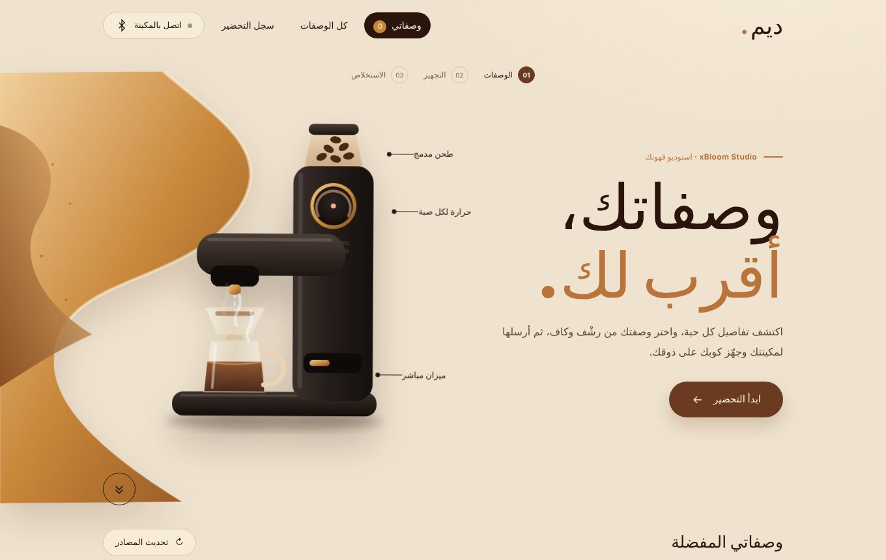

# ديم | Deem xBloom Studio

تطبيق ويب عربي للتحكم بمكينة **xBloom Studio** عبر البلوتوث، والبحث في وصفات **رشْف وكاف**، ومتابعة الاستخلاص وقراءات الميزان مباشرة. يعمل على أندرويد والكمبيوتر عبر Chrome، بواجهة كريمية دافئة بألوان البن والكراميل، وانتقالات سائلة بين الصفحات.

الإصدار الحالي: **1.5.2** · يحتاج **Node.js 22 أو أحدث** · لا يحتاج إلى حزم خارجية.



## الميزات

- الصفحة الأولى للمفضلة، مع بحث في رشْف وكاف بالتوازي ومرشحات المصدر ونوع القهوة والقمع.
- الضغط على بطاقة الوصفة يفتح صفحة التجهيز، وزر القلب يحفظها مستقلًا.
- إرسال الوصفة للمكينة، ثم بدء التحضير بخطوة منفصلة.
- زر البدء يفتح شاشة الاستخلاص مباشرة؛ تبقى القراءات والوقت في انتظار تأكيد المكينة.
- رسم زمني لقراءتي الماء والكوب، ومؤقت وأعمدة بكميات الصبات وحرارتها.
- تنبيهات حالة المكينة من أعلى الشاشة، تختفي بعد خمس ثوانٍ، مع سجل للتنبيهات.
- تعديل نسخة محلية من الوصفة وتصديرها بصيغة JSON.
- تحديث المصادر تلقائيًا أثناء الاستخدام، وإتاحة الوصفات المحفوظة المكتملة إذا تعذّر تحديث المصدر.
- دعم كل سرعة مطحنة صحيحة بين 60 و120 RPM، والاهتزاز قبل/بعد الصب، والأنماط الدائري والحلزوني والمركزي.

## الخط

الواجهة تستخدم خط **Cairo** (رخصة SIL Open Font License) ويأتي مع المشروع في `src/fonts/`، فلا يحتاج إعدادًا إضافيًا.

## تغيير صورة المكينة

صورة المكينة في الصفحة الرئيسية هي `src/img/xbloom-studio.webp` (نسبة 3:4). لاستبدالها ضع صورتك في `src/img/` بالاسم نفسه أو غيّر المسار في `src/index.html`، ثم شغّل `npm run build`. الصيغ المدعومة: SVG وPNG وJPG وWebP وAVIF.

## التشغيل محليًا

```sh
git clone https://github.com/cube2net/deem-xbloom-studio.git
cd deem-xbloom-studio
npm run build
npm start
```

افتح `http://localhost:3000`. يعمل الخادم على `0.0.0.0:3000` افتراضيًا. لإيقافه اضغط `Ctrl+C`.

لتغيير المنفذ على Linux أو داخل حاوية:

```sh
HOST=0.0.0.0 PORT=8080 npm start
```

وعلى PowerShell:

```powershell
$env:HOST = '0.0.0.0'
$env:PORT = '8080'
npm start
```

## التشغيل على خادم أو Docker موجود

استخدم بيئة Node.js 22 أو أحدث، واجعل مجلد المشروع مجلد العمل. نفّذ `npm run build` ثم شغّل `npm start`، ووجّه إعداد الدومين أو الوكيل العكسي إلى منفذ التطبيق.

يجب أن يمرّر الوكيل **كل المسارات، بما فيها `/api/`، إلى خادم التطبيق**. رفع ملفات HTML وCSS وحدها إلى استضافة ثابتة لا يشغّل البحث أو تحديث الوصفات. إذا ظهر خطأ بأن الخادم أعاد HTML بدل JSON، فتحقق من توجيه `/api/` إلى خادم Node.js.

الاتصال بالبلوتوث يحتاج **HTTPS أو localhost**. استخدم Chrome على أندرويد أو الكمبيوتر؛ الاتصال المباشر عبر Web Bluetooth لا يتوفر في كل المتصفحات.

لا توجد مفاتيح API أو حسابات مطلوبة لجلب الوصفات العامة. يحتاج الخادم إلى اتصال خارجي بمواقع المصادر وروابط xBloom العامة.

## استخدام المكينة

1. اختر وصفة من المفضلة أو البحث.
2. افتح تجهيز الوصفة، وشغّل البلوتوث، ثم اتصل بالمكينة. افصل تطبيق xBloom الرسمي إذا كان يستخدم الاتصال نفسه.
3. جهّز البن والماء والفلتر والكوب، وأرسل الوصفة.
4. بعد تأكيد تحميلها، اضغط **بدء التحضير**. هذا الزر يشغّل المكينة ويصب الماء الساخن؛ استخدمه وأنت بجانبها.
5. تابع شاشة الاستخلاص، أو استخدم **إيقاف التحضير** عند الحاجة. تصغير الشاشة لا يوقف المكينة.

البروتوكول غير رسمي. اختبارات البرنامج لا تثبت التوافق الفعلي مع جميع إصدارات المكينة. إذا لم يتأكد الإيقاف فاستخدم زر المكينة.

## التطوير والاختبارات

```sh
npm run build
npm test
```

أعد البناء بعد كل تعديل قبل إعادة تشغيل الخادم. تغطي الاختبارات ترميز البلوتوث وCRC، ومنع البدء المكرر، والبحث، وتحليل المصادر، والنسخ المحفوظة، وحالات الاستخلاص. تعتمد اختبارات المصادر على بيانات اختبار محفوظة ولا تحتاج اتصالًا بالمكينة.

| المسار | الوظيفة |
| --- | --- |
| `src/` | الواجهة العربية، البحث، البلوتوث وشاشة الاستخلاص |
| `worker/index.js` | جلب الوصفات العامة ومسارات API |
| `server.mjs` | خادم Node.js |
| `scripts/build.mjs` | بناء الخادم مع ملفات الواجهة المضمّنة |
| `dist/server/index.js` | الخادم المبني الجاهز للتشغيل |
| `tests/` | الاختبارات وبياناتها |
| `docs/PROTOCOL-NOTES.md` | ملاحظات ترميز البروتوكول ومراجعه |

## التخزين والخصوصية

المفضلة والتعديلات وسجل التحضير محفوظة داخل متصفحك. لا توجد مزامنة تلقائية بين الأجهزة أو الدومينات. إعادة تحميل الصفحة تفقد جلسة الرسم الحالية. بيانات البلوتوث لا تُرسل إلى الخادم؛ الخادم يجلب بيانات الوصفات العامة فقط.

يجب أن تظل الصفحة مفتوحة والمكينة متصلة لاستمرار القراءات والتنبيهات. عند انقطاع الاتصال يُعرض ذلك بوضوح، ولا تُختلق قراءات بديلة.

## الخط والتراخيص

ملفات **خط ثمانية ليست ضمن المستودع العام** لأن ترخيصه يمنع إعادة توزيعها. النسخة العامة تستخدم الخطوط المتاحة على النظام. يمكن الحصول على الخط من [موقع ثمانية الرسمي](https://font.thmanyah.com/) واستخدامه وفق ترخيصه. لا ترفع ملفاته أو تضمّنها في نسخة مبنية منشورة في هذا المستودع.

تظل حقوق الوصفات لمصادرها وأصحابها. التطبيق مستقل وغير تابع لـ xBloom أو رشْف أو كاف. تراخيص الأجزاء الخارجية محفوظة في [THIRD_PARTY_NOTICES.md](THIRD_PARTY_NOTICES.md).

## المصادر

- [رشْف](https://rashf.net/)
- [كاف](https://www.caf-xbloom.com/)
- [xBloom](https://xbloom.com/)
